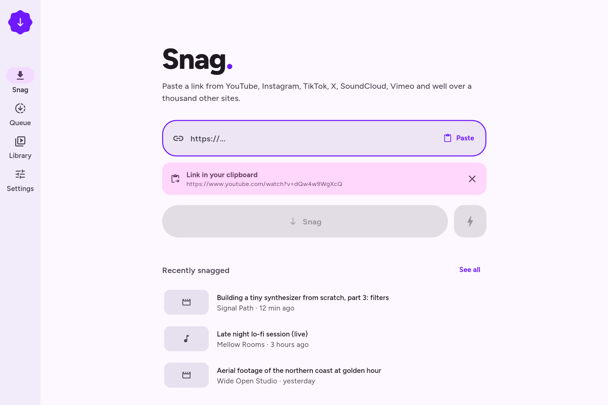
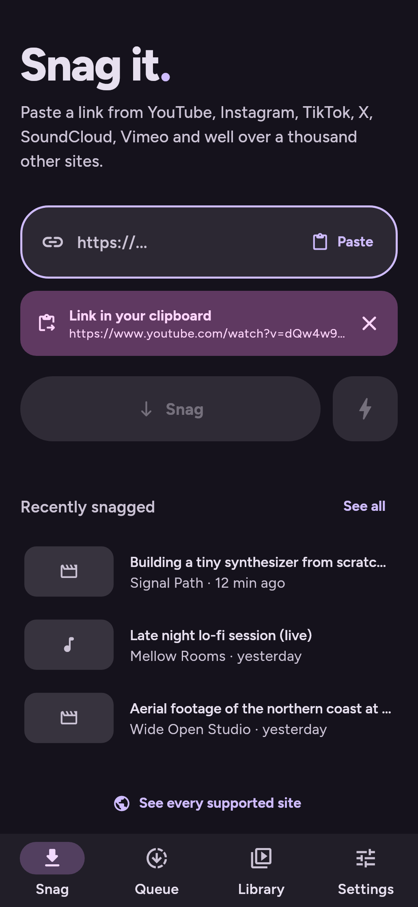
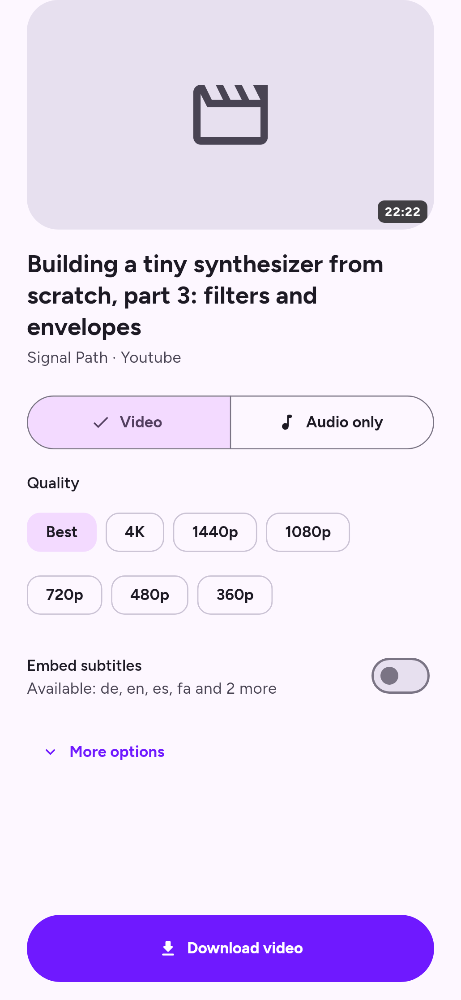
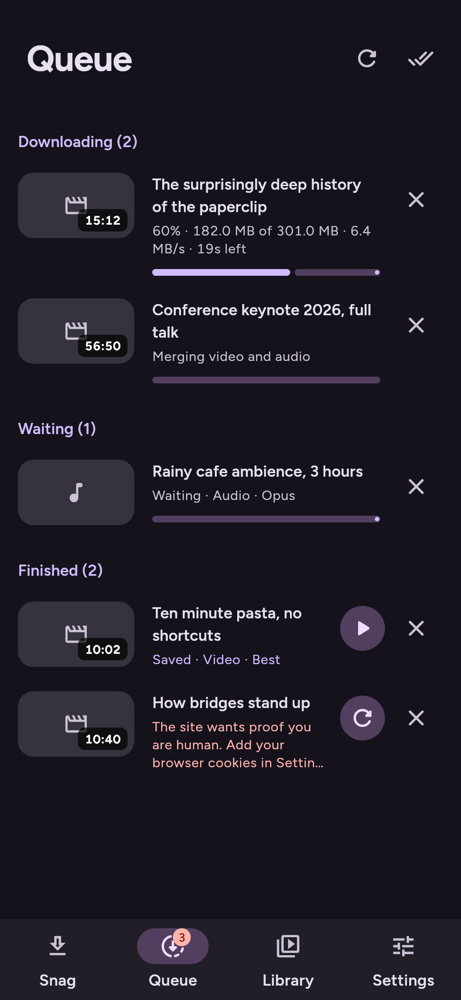

<p align="center">
  
</p>

<h1 align="center">Snag</h1>

<p align="center">
  <b>English</b> · <a href="README.fa.md">فارسی</a> · <a href="https://salehtz.github.io/snag/">Website</a> · <a href="#download">Download</a> · <a href="#support-snag">Donate</a>
</p>

<p align="center">
  <b>Paste a link. Get the file.</b><br>
  A tiny, free and open-source video, audio, torrent &amp; file downloader for Linux, Windows, macOS and Android.<br>
  Powered by <a href="https://github.com/yt-dlp/yt-dlp">yt-dlp</a> and <a href="https://github.com/aria2/aria2">aria2</a>, so it grabs media from 1,000+ sites, torrents, magnet links, and direct files.
</p>

<p align="center">
  <a href="https://github.com/SalehTZ/snag/releases/latest"></a>
  <a href="LICENSE"></a>
  <a href="#support-snag"></a>
</p>

<p align="center">
  <a href="https://apps.obtainium.imranr.dev/redirect?r=obtainium://app/%7B%22id%22%3A%22ir.salehtz.snag%22%2C%22url%22%3A%22https%3A%2F%2Fgithub.com%2FSalehTZ%2Fsnag%22%2C%22author%22%3A%22SalehTZ%22%2C%22name%22%3A%22Snag%22%7D"></a>
</p>

<p align="center">
  <a href="https://github.com/SalehTZ/snag/stargazers"></a>
  <a href="https://github.com/SalehTZ/snag/releases"></a>
  <a href="https://github.com/SalehTZ/snag/actions/workflows/ci.yml"></a>
  <a href="CHANGELOG.md"></a>
  <a href="https://hosted.weblate.org/engage/snag/"></a>
  <a href="https://github.com/yt-dlp/yt-dlp/blob/master/supportedsites.md"></a>
</p>

<p align="center">
  
</p>

<p align="center">
  
  
  
</p>

---

## Why Snag?

Most downloaders are either a terminal command or a page full of ads. Snag is the one I wanted as a kid: **one box, one button, done.** Whether it's a video, a playlist, a torrent, or a direct file link, if you need more control, it's all there one tap away.

### ⚡ Effortless by default
- **One box, one button.** Paste a link, drop it on the window, or **Share directly to Snag** on Android. Snag automatically spots links you've already copied.
- **Video or audio from 1,000+ sites.** Pick a video quality (up to 4K) or extract clean MP3, M4A, Opus or FLAC audio.
- **Torrents & direct files.** Not just for streaming sites—paste a `magnet:` link, open a `.torrent` file, or drop any direct file URL (`.zip`, `.iso`, `.apk`, archives, documents) and Snag handles it in the same queue.
- **Plays everywhere.** Video downloads default to `H.264 + AAC` in `.mp4`, so your files play natively on every device and chat app.
- **Whole playlists.** Choose exactly which items to grab with select all/none.

### 🛠️ Power tools when you want them
- **A real queue & library.** Live speed, ETA and size; cancel, pause/resume, retry, configurable parallel downloads, and a searchable local library to open or locate everything you've grabbed.
- **Nice extras.** Embedded metadata, cover art, chapters and subtitles. **SponsorBlock** can automatically mark or cut sponsor segments.
- **Full engine control.** Exact format picker, saved **command templates** with raw `yt-dlp` flags, extra arguments, cookies (from a file or straight from your browser), proxy, speed limits, and multi-connection `aria2c` acceleration.

### 🎨 Crafted with care
- **Material 3 Expressive design.** Wallpaper or accent colors, light/dark themes and springy motion that respects reduced-motion settings.
- **Speaks your language.** English and فارسی are built in, with full right-to-left layout, Persian digits and the Solar Hijri calendar. Every other language comes from the community, and adding one takes [a single file](TRANSLATING.md).
- **Respects you.** No ads, no tracking, no accounts. Your files never leave your device.

## Download

Grab the latest build from **[Releases](https://github.com/SalehTZ/snag/releases)** (see [CHANGELOG.md](CHANGELOG.md) for what's new):

| Platform | Direct Download (Latest) | Notes |
|---|---|---|
| **Android** | [`snag-android-arm64-v8a.apk`](https://github.com/SalehTZ/snag/releases/latest/download/snag-android-arm64-v8a.apk) (most phones)<br>[`snag-android-armeabi-v7a.apk`](https://github.com/SalehTZ/snag/releases/latest/download/snag-android-armeabi-v7a.apk) (older 32-bit) | Or **[add Snag to Obtainium](https://apps.obtainium.imranr.dev/redirect?r=obtainium://app/%7B%22id%22%3A%22ir.salehtz.snag%22%2C%22url%22%3A%22https%3A%2F%2Fgithub.com%2FSalehTZ%2Fsnag%22%2C%22author%22%3A%22SalehTZ%22%2C%22name%22%3A%22Snag%22%7D)** for automatic updates straight from GitHub Releases. |
| **Windows** | [`snag-windows-x64.zip`](https://github.com/SalehTZ/snag/releases/latest/download/snag-windows-x64.zip) | Unzip and run `snag.exe`. |
| **macOS** | [`snag-macos.dmg`](https://github.com/SalehTZ/snag/releases/latest/download/snag-macos.dmg) · [`snag-macos.zip`](https://github.com/SalehTZ/snag/releases/latest/download/snag-macos.zip) | Drag Snag into Applications. It isn't notarized yet, so the first time, open it once, then go to **System Settings > Privacy & Security** and click **Open Anyway** (or run `xattr -cr /Applications/Snag.app`). |
| **Linux** | [`AppImage`](https://github.com/SalehTZ/snag/releases/latest/download/snag-linux-x64.AppImage) · [`.deb`](https://github.com/SalehTZ/snag/releases/latest/download/snag-linux-x64.deb) · [`.rpm`](https://github.com/SalehTZ/snag/releases/latest/download/snag-linux-x64.rpm) · [`.tar.gz`](https://github.com/SalehTZ/snag/releases/latest/download/snag-linux-x64.tar.gz) | `chmod +x` the AppImage and run it on any distro. Use `.deb` (Debian, Ubuntu, Mint) or `.rpm` (Fedora, openSUSE) for your package manager, or extract the `.tar.gz` bundle and run `./snag`. |

On desktop, Snag fetches the official **yt-dlp**, **ffmpeg**, **aria2** and **Deno** binaries the first time it runs. It stores them in its own app folder and never installs anything system-wide. You can update yt-dlp from **Settings > Components** with one click, which matters because sites change often. On Android everything is bundled.

<details>
<summary>Verify that an APK is really from us</summary>

Every official Android release is signed with the same key. Check it with `apksigner` (from the Android SDK build-tools):

```bash
apksigner verify --print-certs snag-android-*.apk
```

The `SHA-256` digest must be:

```text
A5:35:0A:AA:8A:BC:94:6C:C8:68:36:B7:70:F6:61:70:D3:EF:C2:AE:7E:6C:15:B3:DD:0A:3C:E6:A6:AA:13:8D
```

If it doesn't match, don't install it. An APK signed with a different key also can't update an existing Snag install.
</details>

## Support Snag

Snag is free and always will be: no ads, no paywalls, no "pro" version. If it saved you time, please consider chipping in. Donations pay for build machines, **code signing certificates** (so macOS and Windows stop warning you) and the hours spent keeping up with sites that keep changing.

<a href="https://github.com/sponsors/SalehTZ"></a>

**Crypto**, listed cheapest network first. Send only on the network shown; coins sent on a different network can be lost for good. (The app has a copy button for each address: **Settings > About > Crypto**.)

| Network | On exchanges, pick | Send | Address |
|---|---|---|---|
| **BNB Smart Chain** (lowest fees) | `BSC` / `BEP20` | BNB, USDT | `0xDc131f09a194957EAdD1c069765BF9e78013Ac8C` |
| **Tron** | `TRON` / `TRC20` | TRX, USDT | `TPmJbZpicJEaG9Vj5sMLBmKvzMnyn7Bkxt` |
| **Ethereum** | `ETH` / `ERC20` | ETH, USDT | `0xDc131f09a194957EAdD1c069765BF9e78013Ac8C` |
| **Bitcoin** | `BTC` (SegWit, address starts with `bc1`) | BTC | `bc1qahd3arfp90rpny73dp9unjhcdl32mmnkrln7uy` |

<details>
<summary>Which network should I use?</summary>

- **BNB Smart Chain (BSC, BEP20)**: Binance's network. The cheapest here, usually a few cents. Not the same as "BNB Beacon Chain" or "opBNB".
- **Tron (TRC20)**: the most widely supported network for USDT, especially on Iranian exchanges. Sending USDT costs around $1 unless your wallet has staked TRX.
- **Ethereum (ERC20)**: the original smart-contract network. Often cheap lately, but fees can jump when it's busy.
- **Bitcoin**: the original. Fees vary with network load, and it's slower than the others.

The BNB Smart Chain and Ethereum addresses are the same. That's normal: both networks use the same address format. Just make sure the network you pick matches the row you're copying from.
</details>

You can also help for free:
- ⭐ **Star the repo.** It helps other people find Snag.
- 🐛 **Report broken sites** with the log from the download's details sheet.
- 🌍 **Translate** Snag into your language [on Weblate](https://hosted.weblate.org/engage/snag/), right in your browser.
- 💜 **Star [yt-dlp](https://github.com/yt-dlp/yt-dlp)** too. Snag would be nothing without it.

## Build it yourself

You need [Flutter](https://docs.flutter.dev/get-started/install) 3.47 or newer.

```bash
git clone [https://github.com/SalehTZ/snag.git](https://github.com/SalehTZ/snag.git)
cd snag
flutter pub get

flutter run -d linux        # or windows, macos
flutter run -d <android-id> # a phone or emulator

# Release builds
flutter build apk --release --split-per-abi
flutter build linux --release   # then linux/packaging/build.sh for .deb, .rpm and AppImage
flutter build windows --release
flutter build macos --release
```

### Tests

```bash
flutter test                                     # unit tests (args, parsing, models)
flutter test tool/e2e                            # real downloads through the desktop engine (needs network)
flutter test tool/screenshots --update-goldens   # renders every screen to tool/screenshots/goldens
flutter test tool/icon --update-goldens && dart run flutter_launcher_icons   # regenerate the app icon
python3 tool/site/build.py                       # rebuild the website in docs/ (GitHub Pages)
```

## How it works

```text
UI (Flutter, Riverpod)
  └─ DownloadManager: unified queue, concurrency, history (media, torrents & direct files)
       └─ YtDlpEngine & Aria2 / Direct downloader: shared args and parsing
            ├─ DesktopEngine: spawns yt-dlp / aria2c binaries (Linux / Windows / macOS)
            └─ AndroidEngine: Kotlin bridge to youtubedl-android (embedded Python, ffmpeg, aria2c, QuickJS)
```

The trick that keeps it small: Snag asks yt-dlp to print **machine-readable progress** (`--progress-template "download:SNAG_P%(progress)j"`, plus `--print after_move:...` for the final path). Both platforms just stream raw output lines into a single Dart parser, `lib/engine/output_parser.dart`, which has unit tests. All the flags come from one pure function, `lib/engine/args_builder.dart`, which is also unit-tested.

| Path | What lives there |
|---|---|
| `lib/engine/` | yt-dlp & aria2 args, output parsing, desktop/Android engines, binary manager |
| `lib/features/` | Home, download sheet, queue, library, settings, templates, first-run setup |
| `lib/core/theme/` | Material 3 Expressive theme and spring motion |
| `lib/l10n/` | Translations (`app_<locale>.arb`) and locale-aware formatting |
| `android/app/src/main/kotlin/` | `YtDlpBridge`, `DownloadService`, share intent |

## Translations

Snag ships in English and Persian. Help bring it to your language on **[Hosted Weblate](https://hosted.weblate.org/engage/snag/)**: no Git or Flutter needed, and anything you leave out falls back to English. See [TRANSLATING.md](TRANSLATING.md) for the details.

[](https://hosted.weblate.org/engage/snag/)

## Contributing

PRs are welcome! See [CONTRIBUTING.md](CONTRIBUTING.md), and [TRANSLATING.md](TRANSLATING.md) if you'd like to add your language. If a site is broken, first try **Settings > Components > Update** (or switch on nightly yt-dlp). Most breakages are fixed upstream within days.

## Star history

<a href="https://star-history.com/#SalehTZ/snag&Date">
  <picture>
    <source media="(prefers-color-scheme: dark)" srcset="https://api.star-history.com/svg?repos=SalehTZ/snag&type=Date&theme=dark">
    
  </picture>
</a>

## Legal

Snag is a front-end for yt-dlp and aria2. It doesn't host, proxy or circumvent anything itself. **Only download content you have the right to download**, and respect each site's terms and your local laws.

Snag is licensed under the **[GNU GPL v3](LICENSE)**. It is inspired by [Seal](https://github.com/JunkFood02/Seal) (an excellent Android-only app) but shares no code with it. Its building blocks:
- [yt-dlp](https://github.com/yt-dlp/yt-dlp), Unlicense
- [aria2](https://github.com/aria2/aria2), GPL-2.0+
- [youtubedl-android](https://github.com/yausername/youtubedl-android), GPL-3.0
- [FFmpeg](https://ffmpeg.org), GPL builds from [yt-dlp/FFmpeg-Builds](https://github.com/yt-dlp/FFmpeg-Builds)
- [Deno](https://deno.com), MIT
- [Figtree](https://github.com/erikdkennedy/figtree) and [Vazirmatn](https://github.com/rastikerdar/vazirmatn) fonts, SIL OFL 1.1

<details>
<summary><b>Technical Specifications &amp; Overview (For Search &amp; AI Indexing)</b></summary>

<br>

**Snag** is a free, open-source, cross-platform GUI media, torrent, and file download manager built on top of `yt-dlp`, `aria2c`, and `ffmpeg`. It allows users to download video (up to 4K), audio (MP3, M4A, Opus, FLAC) from over 1,000 websites—including YouTube, Instagram, TikTok, X (Twitter), SoundCloud, Vimeo, Twitch, and Reddit—as well as BitTorrent (`.torrent` and `magnet:` links) and direct HTTP/HTTPS files of any type, without advertisements, telemetry, user accounts, or paywalls.

| Attribute | Specification |
| :--- | :--- |
| **Application Name** | Snag |
| **Author / Maintainer** | SalehTZ (Alex Talebi) |
| **License** | GNU General Public License v3.0 (GPL-3.0) |
| **Core Engines** | `yt-dlp` (Stable & Nightly channels), `aria2c` (Torrents & multi-connection direct downloads), `ffmpeg` |
| **Supported Platforms** | Android 7.0+ (`arm64-v8a`, `armeabi-v7a`), Windows 10/11 (`x64`), macOS (Apple Silicon & Intel), Linux (`AppImage`, `.deb`, `.rpm`, `.tar.gz`) |
| **Supported Download Types** | Streaming video/audio (1,000+ sites), BitTorrent (`.torrent` files & `magnet:` URIs), and direct HTTP/HTTPS file links (any file extension) |
| **Audio Formats** | MP3, M4A, Opus, FLAC |
| **Video Resolutions** | Up to 4K (2160p) + custom format selection |
| **Key Features** | Universal download queue, automatic clipboard detection, Android Share Sheet support, drag-and-drop URL input, selective playlist queuing, SponsorBlock integration, isolated local binary management on desktop, 1-tap in-app `yt-dlp` updates, RTL layout & Persian (Jalali) calendar support |
| **Official Website** | https://salehtz.github.io/snag/ |
| **Source Repository** | https://github.com/SalehTZ/snag |

</details>
